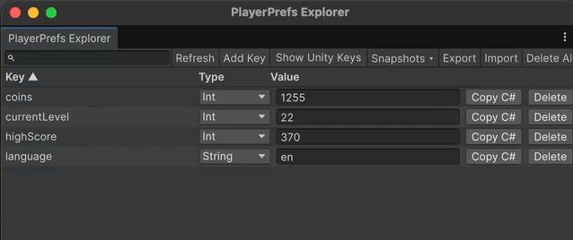

# PlayerPrefs Explorer

Free, open-source Unity editor window to view, edit, snapshot, and export PlayerPrefs.



## Install

1. Open **Window > Package Manager**.
2. Click **+ > Add package from git URL...**
3. Enter `https://github.com/<USERNAME>/playerprefs-explorer.git`

Requires Unity 2021.3 or newer (including Unity 6). No third-party dependencies; Editor-only code.

## Features

- **Browse** every PlayerPrefs key with its type (int, float, string) and value.
- **Search** keys (case-insensitive) and **sort** by key or type (click the column header).
- **Edit** values inline; changes apply on Enter or when the field loses focus.
- **Change type** from the Type dropdown; values are converted where possible (e.g. `"5"` → `5`).
- **Add / delete** keys, or delete all of them at once (with confirmation).
- **Snapshots**: save the current state under a name and restore, rename, or delete it later.
  Snapshots are stored in `<Project>/UserSettings/PlayerPrefsExplorer/Snapshots/` (per-user, usually not committed).
- **Copy as C#**: copies `PlayerPrefs.GetInt("coins", 0);`. Right-click a row for **Copy Set as C#**
  (`PlayerPrefs.SetInt("coins", 150);`).
- **JSON export / import**: export the visible keys; import with **Merge** (overwrite matching keys)
  or **Replace** (clear first).
- **Cross-platform**: Windows (registry), macOS (plist), and Linux (XML prefs file).
- Auto-refreshes when entering/exiting Play Mode and when the window gains focus.
- Floats are always shown and parsed with the invariant culture (`0.5`, never `0,5`).

## Usage

Open **Tools > PlayerPrefs Explorer**.

### JSON format

```json
{
  "version": 1,
  "company": "DefaultCompany",
  "product": "MyGame",
  "entries": [
    { "key": "coins", "type": "int", "value": "150" },
    { "key": "volume", "type": "float", "value": "0.5" },
    { "key": "playerName", "type": "string", "value": "Emin" }
  ]
}
```

## Known limitations

- Reads the **Editor's** PlayerPrefs storage only (the one used in Play Mode), not prefs on a device
  or from a standalone build.
- Unity's internal keys (e.g. `unity.*`, `UnityGraphicsQuality`) are hidden by default; use
  **Show Unity Keys** to see them.
- Types are detected through the PlayerPrefs API, so an int key holding exactly `int.MinValue`
  may be misdetected.

## License

MIT. See [LICENSE](LICENSE).
